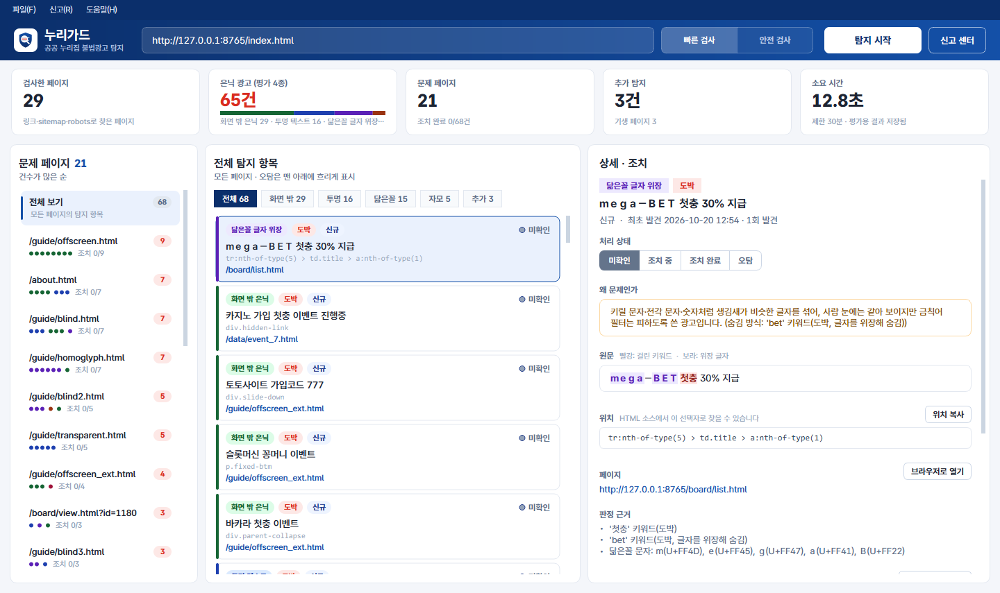
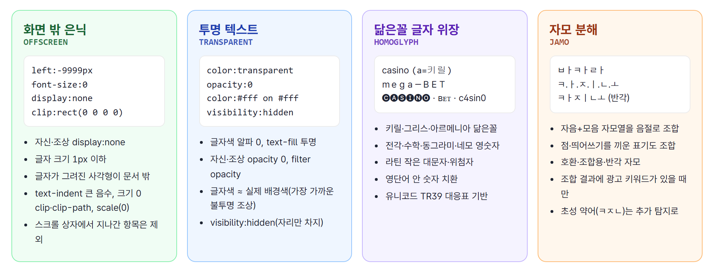
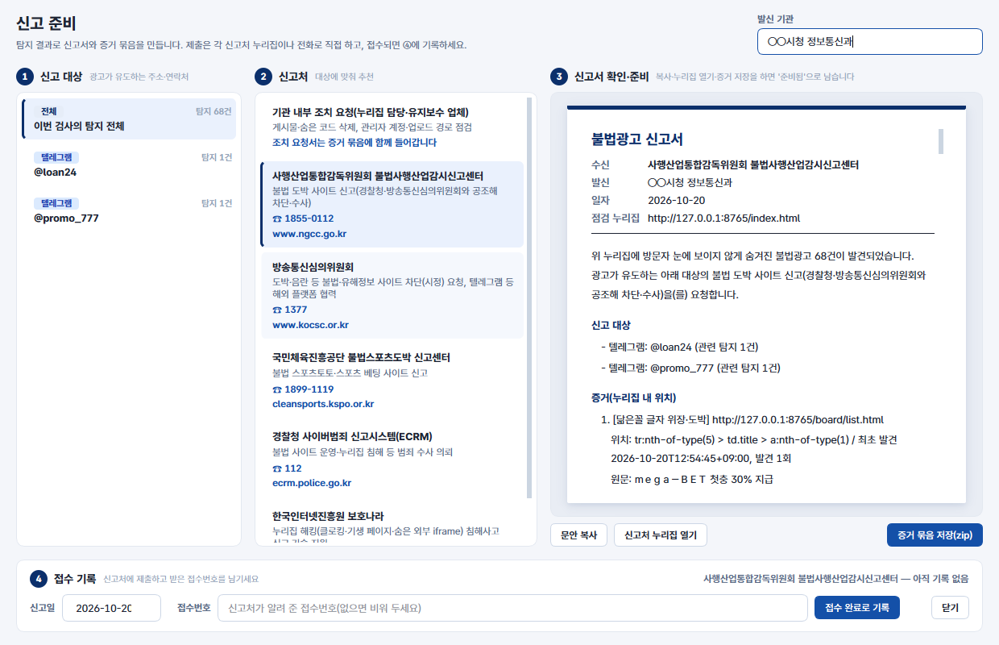

# 누리가드 · NuriGuard

**공공 누리집에 몰래 심어진 불법광고를 찾아내는 점검 도구**

주소 하나만 넣으면 누리집 전체를 돌며 사람 눈에 보이지 않게 숨긴 도박·성인·불법 대출 광고를 찾습니다. 
어디에 숨었는지와 증거, 신고할 곳까지 정리해 줍니다.

행정안전부 · 한국지능정보사회진흥원(NIA) 「공공 웹사이트 불법광고 탐지 도구 개발 공모전」 출품작

 

---

## 왜 만들었나

공공기관 게시판과 오래된 페이지에 불법도박 광고가 몰래 끼워지는 일이 반복되고 있습니다.
이런 광고는 방문자 눈에는 보이지 않게 숨기고 검색엔진에만 노출합니다. 그래서 담당자가 화면을 둘러보는 것만으로는 찾기 어렵습니다.

누리가드는 **실제 브라우저로 페이지를 그린 뒤**, 화면에는 보이지 않는데 문서 안에 남아 있는 광고 글을 찾아냅니다.

<table>
<tr>
<td align="center" width="25%"><h3>65 / 65</h3>테스트베드 정답 검출 오답 0</td>
<td align="center" width="25%"><h3>0건</h3>실제 공공 누리집 8곳 오탐</td>
<td align="center" width="25%"><h3>6분 39초</h3>1,000쪽 검사 (페이지당 0.4초)</td>
<td align="center" width="25%"><h3>30분 안</h3>시간이 다 되면 그때까지 결과를 확정</td>
</tr>
</table>

---

## 무엇을 찾나

| 숨김 수법 | 예 |
|---|---|
| **화면 밖 숨김** | 글자를 화면 바깥으로 밀어내거나 크기를 0으로 만듦 |
| **투명 텍스트** | 글자색을 투명하게 하거나 배경색과 같게 함 |
| **닮은꼴 글자** | 모양이 같은 키릴·전각·작은 대문자를 섞음 (`cаsino`, `ｍｅｇａ－ＢＥＴ`) |
| **자모 분해** | 한글을 자음·모음으로 풀어 씀 (`ㅂㅏㅋㅏㄹㅏ`) |

이 밖에도 다음 여덟 가지를 함께 찾습니다.

> 🔍 **클로킹** 검색봇(구글·**네이버·다음**)에게만 다른 내용을 보여 줌 &nbsp;·&nbsp; 📄 **기생 페이지** 메뉴로는 갈 수 없게 몰래 만든 광고 페이지 
> 🔗 **불법 사이트 연결** 누리집 링크가 도박 사이트로 이어짐 &nbsp;·&nbsp; 🚫 **불법 사이트** 도착한 곳 자체가 불법 사이트 
> 🪟 **숨은 iframe** 보이지 않는 틀로 외부 페이지를 끼워 넣음 &nbsp;·&nbsp; 🖼️ **이미지 배너** 그림으로 만든 광고 
> ⚠️ **위험 링크** 광고 문구와 함께 걸린 외부 링크 &nbsp;·&nbsp; 🔤 **초성 약어** `ㅋㅈㄴ` → 카지노

---

## 어떻게 다른가

<table>
<tr>
<td width="50%" valign="top">

**🖥️ 화면 그대로 판정합니다** 
소스 코드만 훑지 않고, 브라우저가 실제로 그린 색·투명도·크기·좌표로 숨김 여부를 확인합니다.

</td>
<td width="50%" valign="top">

**🇰🇷 한국어 변형을 풉니다** 
자모 분해, 닮은꼴 글자, 초성 약어를 원래 낱말로 되돌려 광고인지 판단합니다.

</td>
</tr>
<tr>
<td valign="top">

**📍 고칠 수 있는 증거를 남깁니다** 
광고가 숨은 위치(CSS 선택자), 스크린샷, iframe 경로를 함께 기록합니다.

</td>
<td valign="top">

**✅ 정상적인 숨김은 제외합니다** 
'본문 바로가기' 같은 접근성용 숨김, 접힌 메뉴, 단속 공지는 광고로 보지 않습니다.

</td>
</tr>
<tr>
<td valign="top">

**📦 설치와 인증이 필요 없습니다** 
Windows 실행 파일 하나로 동작합니다. 사이트 소유 인증도, 외부 AI 서비스도 쓰지 않습니다.

</td>
<td valign="top">

**⚙️ 두 가지 검사 모드** 
**빠른 검사**는 짧은 시간 안에 전체를 점검합니다. **안전 검사**는 운영 중인 누리집에 부담을 주지 않도록 속도와 검사 항목을 직접 정합니다.

</td>
</tr>
</table>

---

## 찾은 다음, 신고까지

광고가 유도하는 텔레그램·사이트를 모으고, 알맞은 신고처를 추천하고, 신고서를 만듭니다.
위변조를 확인할 수 있는 증거 묶음(SHA-256)을 저장하고, 접수번호와 처리 상태까지 이력으로 관리합니다.
다시 검사하면 새로 생긴 것, 계속 남은 것, 해결된 것을 나눠 보여 줍니다.

 

누리가드 · 공공 누리집을 깨끗하게

